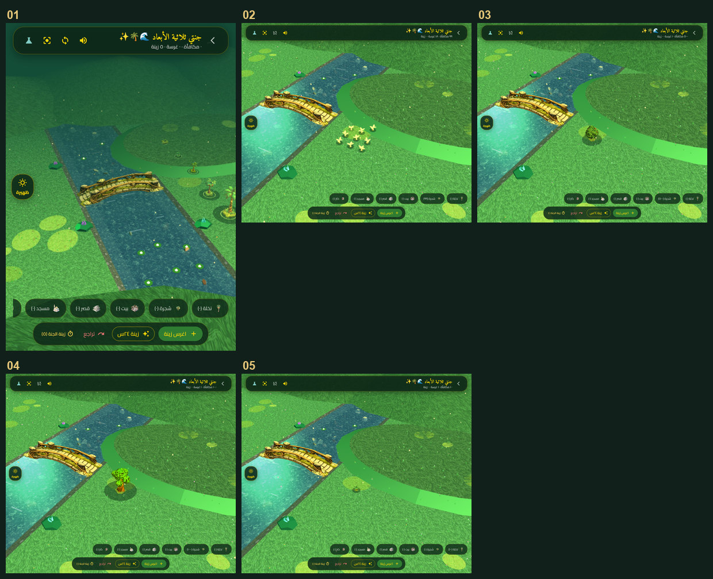
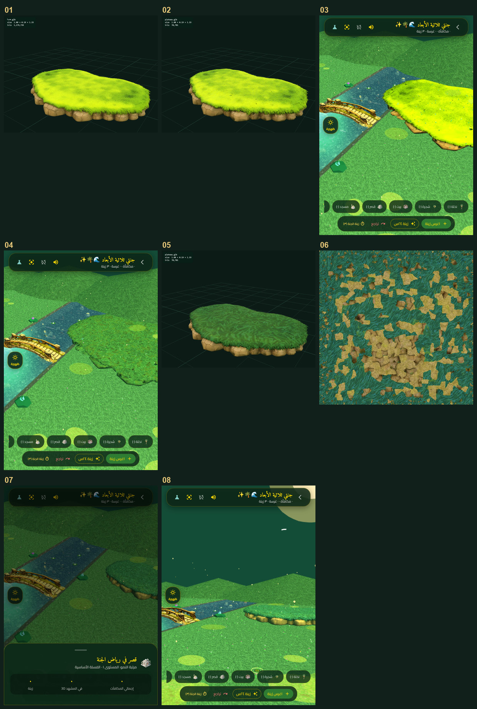
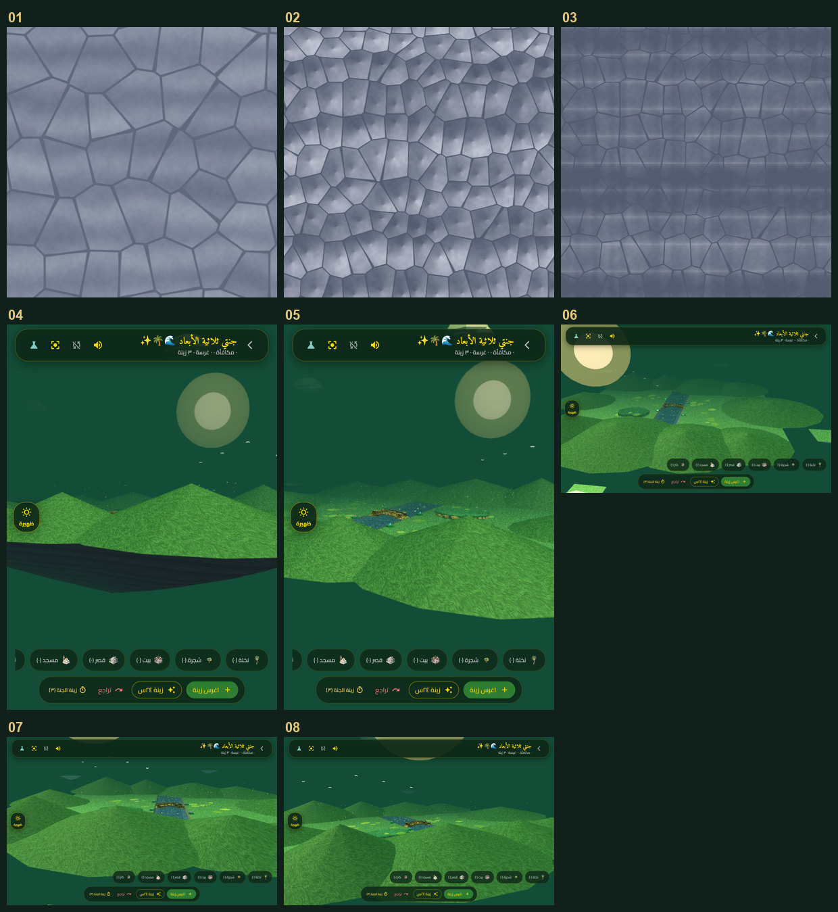
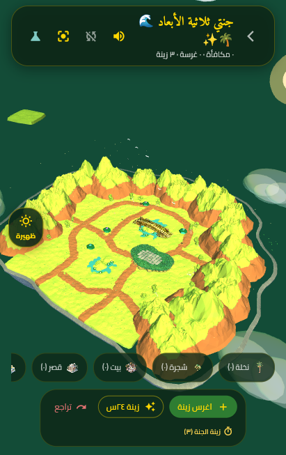

# سجل تطوّر المشهد ثلاثي الأبعاد

**المجلد:** `docs/evolution/`
**آخر تحديث:** ١٦ نوفمبر ٢٠٢٦

> **ابدأ من هنا:** [`index.html`](index.html) — فهرس المراحل الأربع بأزرار تنقّل
> بينها. كل مرحلة لها صفحة HTML مستقلة (`REPORT.html`) باللقطات والقرارات.
> هذا الملف يبقى النصّ المصدر (Markdown) لمن يقرأ من المستودع مباشرة.
>
> **الحالة الحالية والخطة:** [`../../PROJECT.md`](../../PROJECT.md) هو المصدر الوحيد.
> هذا المجلد سجل تاريخي للقرارات البصرية، لا قائمة مهام.

هذا المجلد يحفظ **لقطات الشاشة** التي وُثّق بها قرار كل مرحلة من مراحل بناء عالم
«جنتي» ثلاثي الأبعاد، مرتّبة زمنيًا. الغرض منه أن يعود إليه أي شخص بعد شهور ليعرف
**لماذا** صار المشهد هكذا، لا كيف شكله فقط: كل لقطة تقابل قرارًا اتُّخذ أو طريقًا
جُرّب ورُفض.

اللقطات مضغوطة JPEG بجودة ٨٨٪ وعرض أقصى ١٢٠٠px (إحدى وعشرون لقطة + لوحة تجميع
لكل مرحلة، ~٥٫٢ م.ب) لأن الأصلية PNG كانت تتجاوز ٣٠ م.ب. الصور الأصلية غير موجودة
في المستودع.

---

## كيف التُقطت

كل اللقطات من **Chrome حقيقي** يشغّل `build/web` المنشور محليًا، عبر بروتوكول CDP
(لا صور مركّبة ولا محاكاة). سكربتات التصوير كانت في المجلد المؤقت، ولم تُحفظ في
المستودع؛ المهم هو النتيجة. الخادم: `http://127.0.0.1:8090/`، والتحكم: منفذ CDP
`61365`.

> ملاحظة متكررة: `Emulation.clearDeviceMetricsOverride` مطلوب قبل أي لقطة وإلا خرجت
> الصورة بمقاس الجهاز الافتراضي لا بالمقاس المطلوب.

---

## المرحلة ١ — الأشجار والمراتب (`2026-11-12-trees-and-tiers`)

الهدف: استبدال مجسّمات الشجر الإجرائية بأصول حقيقية، وضبط سلّم الأحجام والدفن في
الأرض.

[](2026-11-12-trees-and-tiers/00-contact-sheet.jpg)

| اللقطة | ما تُثبته |
|--------|----------|
| `01-tint-stage-0-vs-2.jpg` | مقارنة المرحلة ٠ (بلا تلوين) بالمرحلة ٢ على المراتب الخمس — المرجع الذي حسم نسبة المزج |
| `02-tree-tier-1.jpg` | الشتلة في المرتبة ١ داخل عشب المرج بارتفاع ٠٫٦ |
| `03-tree-tier-4.jpg` | الشجرة المثمرة في المرتبة ٤ |
| `04-tree-tier-5.jpg` | الشجرة السماوية في المرتبة ٥ عند سقف ٩ وحدات |
| `05-ground-sink-palms.jpg` | النخيل بعد الدفن — القاعدة العشبية لم تعد «عشبًا بطول الموديل» |

**القرارات:**

- الأشجار الخمس مقصوصة من `assets/trees.glb` بنسب تبسيط **لكل قطعة على حدة**
  (`0.65 / 0.18 / 0.0157 / 0.0097 / 0.0085`). التبسيط الموحّد ٠٫٠١٢ على الملف كله
  دمّر الشتلة (٩٣ مثلثًا)، فالقصّ أولًا غير قابل للتفاوض.
- التلوين **مزج ٠٫٤٥ + وهج ٠٫١٨، لا ٠٫٨**. المادة تُضرب في صورة الخامة، فمزج ٠٫٨ —
  المعاير على المجسّمات الإجرائية المسطّحة — كان يمحو خامة النخيل ويحوّل السعف
  النعناعي إلى ليموني.
- الدفن في الأرض يُطرح **بعد** تثبيت القاعدة على الصفر، فتبقى `fitModelToGround`
  idempotent. نسب النخيل `0.40 / 0.16 / 0.13 / 0.13 / 0.15` والشجر `0.10`،
  والمباني والكنوز لا تُدفن.

---

## المرحلة ٢ — الهضبة (`2026-11-12-13-plateau`)

الهدف: رفع الهضبة الوسطى من أرض مسطّحة إلى مجسّم حقيقي بجرف صخري، دون المساس
بمواضع الزرع ولا بانحناءات المرج.

[](2026-11-12-13-plateau/00-contact-sheet.jpg)

| اللقطة | ما تُثبته |
|--------|----------|
| `01-source-asset.jpg` | الأصل `assets/هضبة.glb` كما وصل — ١٫١٨ مليون مثلث |
| `02-first-pass-70k-triangles.jpg` | تمريرة أولى عند ٧٠ ألف مثلث: الشكل صحيح لكن الخامة ضاعت |
| `03-v2-cylinder-base.jpg` | محاولة قاعدة أسطوانية — **مرفوضة**: حدّ اصطناعي دائري |
| `04-v4-uniform-scale.jpg` | مقياس موحّد: لا تمطيط، النسبة ١٫٨٨:١٫٣٣ محفوظة |
| `05-model-natural-proportions.jpg` | الشكل الطبيعي كما طُلب — التكستشر لا يتبدّل |
| `06-final-colour-atlas.jpg` | أطلس الألوان النهائي ٢٠٤٨px — اللون داخل الصورة لا في المادة |
| `07-palaces-planted.jpg` | القصور الثلاثة بعد الغرس على السطح |
| `08-final-in-scene.jpg` | الهضبة في المشهد الكامل من كادر الافتتاح |

**القرارات:**

- المقياس النهائي `42.9 × 4.34 × 30.4` موحّدًا (نسبة الأصل ١٫٨٨:١٫٣٣)، **لا تمطيط**.
  التمطيط كان يفسد اتجاه حراشف العشب ويحوّل الجرف إلى شريط.
- سطح المشي `_kPlateauHeight = 4.08` لا ٤٫٣٤. القياس: الوسيط ٤٫٠٧ وp99 عند ٤٫١٩،
  فالـ٤٫٣٤ هو رؤوس العشب لا الأرض. أي موديل يزرع عند ٤٫٣٤ يطفو فوق السطح.
- اللون يُطبخ **داخل** الخامة (`MEADOW_TINT` في الملف + مادة بيضاء). تعديل لون
  المادة يضرب الصورة كلها فيمحو تفاصيل الجرف الرملي.
- `TILE = 2` في الصورة نفسها لا في UV — التكرار في UV يخلق حدودًا مرئية عند
  الحواف المستديرة.
- JPEG بجودة ٩٠ للخامة الكبيرة: ٠٫٩٤ م.ب بدل ٢٫٩ م.ب بلا فرق مرئي.

---

## المرحلة ٣ — الجزيرة الطافية (`2026-11-13-floating-island`)

الهدف: تحويل الأرضية إلى **مجسّم بسماكة** بجرف صخري وثلاث جزر صغيرة طافية وسحب
سفلية — أسلوب Clash of Clans — بلا مساس بالسماء ولا بلوحة النهار ولا بمواضع الزرع.

[](2026-11-13-floating-island/00-contact-sheet.jpg)

| اللقطة | ما تُثبته |
|--------|----------|
| `01-cliff-map-mosaic.jpg` | محاولة خامة جرف رقم ١: بلاطات زجاجية — **مرفوضة** |
| `02-cliff-map-scales.jpg` | محاولة رقم ٢: حراشف زواحف/فسيفساء — **مرفوضة** |
| `03-cliff-map-layered-stone.jpg` | المحاولة الثالثة: صخر طبقي متشقق ✅ |
| `04-shell-unlit-underside.jpg` | القشرة قبل الإضاءة: الجرف أسود تمامًا — الدليل على الحاجة لضوء ارتداد |
| `05-island-far-low.jpg` | زاوية أدنى: القشرة خرجت من الكادر، والجزيرة تُقرأ كتلة عشب. الجزر الصغيرة تظهر بصخور بنية تحتها |
| `06-home-default-camera.jpg` | كادر الافتتاح: لا جرف ولا جزر طافية مرئية، والقمم المحيطية تسدّ الوسط |
| `07-wide-default-angle.jpg` | أقصى تصغير: القمم المحيطية تغطي وسط الكادر والنهر/الجسر يصغُران إلى شريط |
| `08-wide-low-angle.jpg` | بعد تدوير الكاميرا: القمم الخضراء تحجب القشرة تمامًا |

**القرارات:**

- خامة الجرف **إجرائية** (`cliff_rock.png`، ٥١٢px، ١٦٠ ك.ب) لأن الجرف يُبنى في
  الكود ولا يوجد له أطلس في أي أصل. مولّدها `tool/assets/prep_cliff_texture.py`:
  فورونوي ملتوٍ + طبقات أفقية + حبيبات.
- لون الخامة **بارد** (متوسط ٩٨،١٠٥،١٢٥) عن قصد: شمس الظهيرة `0xFFE082` تضاعف
  الأحمر/الأخضر وتخفض الأزرق، فيصل الصخر إلى الشاشة رماديًا دافئًا لا أصفر.
- حلقة الجرف العليا عند **١٤٠×٩٠ بالضبط** (`r = 0`) لتطابق حدّ المرج، ثم ١٤١×٩١
  عند `y = −1.6` كحافة بارزة. أي فرق في النصف الأيمن يظهر كخط أسود.
- القمة تُغلق بحلقة صغيرة + مروحة مثلثات. لا تُترك ١٢٨ نقطة متطابقة: نواظمها
  تتلاشى ويخرج السطح أسود.
- تكرار UV يُحسب من المحيط الفعلي `4*(a+b)/tile` مع `tile = 26`، فالحافة والجرف
  يستخدمان نفس مقاس الحجر.
- **الجرف يخرج أسود بلا ضوء ارتداد** لأنه يواجه عكس الشمس دائمًا. الحل: ضوءان
  من الأسفل (`0x9DB2C4` من `(26,−70,44)` و`(−30,−70,−46)`) مربوطان بشدة
  `spec.ambientIntensity`، فيتبعان دورة النهار.
- اتجاه لفّ مثلثات الجدار `[a, b, c, b, d, c]` يعطي نواظم للخارج. الترتيب المعتاد
  `[a, c, b]` يقلبها ويجعل السطح الداخلي هو المرئي.

---

## المرحلة ٤ — الجزيرة الطبيعية (`2026-11-16-nature-island`)

الهدف: استبدال الأرض المسطّحة والنهر المحفور بجزيرة `PP_FreeLowPolyForest_v3.0`
كاملة — جبال وبحيرتان وممرات ومرج — تُستنسخ من ١٧ شبكة بدل نسخة مسطّحة، ثم ضبط
كادر الافتتاح والفساحة والهضبة فوق البيئة الجديدة.

[](2026-11-16-nature-island/REPORT.html)

| الملف | ما يُثبته |
|-------|----------|
| `01-empty-island.png` | الجزيرة الفارغة قبل الإصلاح: ١٧ طلب ٤٠٤ ولا شجرة واحدة |
| `02-inside-mountains.jpeg` | بعد الإصلاح، والكاميرا الافتراضية داخل حلقة الجبال |
| `03-whole-island.jpeg` | الجزيرة كاملة من بعيد — الكادر المرجعي قبل ضبط الميل |
| `04-home-framing.png` | كادر البداية المطبَّق: ميل ٣٦°، الجزيرة كاملة، الحدّ السفلي على شريط الـHUD |
| `05-plateau-rim.png` | الهضبة بعد إرجاع خامتها الأصلية: سطح أخضر داكن، الرصف الحجري، ولا حلقة صخور (مقتطع مكبّر ×٣) |

**القرارات:**

- `assets/3d/nature/` تُسرد **٣٤ سطرًا** في `pubspec.yaml` (١٧ GLB + ١٧ صورة).
  المدخل المجلدي غير متداخل، وغيابها كان يعني جزيرة فارغة بلا أي خطأ في Flutter.
- **٢٤٥ نسخة** من **١٧ شبكة**، تُستنسخ من قوالب (~٢ م.ب) لا نسخة مسطّحة (٤٥–٧٢ م.ب).
- الحدّ الخارجي `kNatureOutline` (١٢٨ نقطة) مقتطع من مثلثات الأرض نفسها، والبصمة
  **٢٠٧ × ١٧٦** وحدة ومستوى الماء `kNatureWaterY = −0.75`.
- حراسة جديدة في `test/asset_map_test.dart`: «كل شبكة يسردها nature_layout معلنة
  وموجودة».
- **الكادر**: `_kHome*` = كاميرا **(150, 172, 180)** → هدف **(0, 2, 0)** — مسافة
  **٢٨٩٫٥**، ميل **٣٦°** (البعيد أعلى والقريب أسفل)، وسمت **٣٩٫٨°** عن `+z` أي
  **بلا دوران يمين/شمال**. حدود النظر **±110 / ±95** تغطي الجزيرة كاملة،
  و`maxDistance = 340`، والضباب **400 → 1000** بدل `150 → 460`.
- **الفساحة**: تصغير مجسّمات البيئة حول قاعدتها فقط — الجبال **٠٫٨٠**، الشجر
  والصخور **٠٫٨٥**. بلاطات المرج والبحيرات **بلا تصغير** لأن المرج مرصوف بها بلا
  تراكب فأي تصغير يفتح فجوة. الجسر: الطول **١٦٫٩ ثابت** (يغطي البحيرة ٣٢ وحدة)،
  والعرض ٨٫٩ → **٨٫٠**، والارتفاع ١٠٫٢ → **٨٫٨**، والمركز `y = 1.54`.
- **الهضبة**: أُرجعت خامة `plateau.jpg` الأصلية — أطلس واحد يحمل عشب السطح
  وجرفه الصخري. استبدالها بـ`ground_spots` مع `_tileModelUv(scene, 3.0)` وإضافة
  **١٠ صخور** `rock_moss_a/b` جُرِّب ثم **حُذف**: السطح خرج فطيرة باهتة والصخور
  حلقة بيضاء. الهندسة والرصف (٣٦ بلاطة) ومواضع الزرع لم تُمس.
- **المشهد الأسود**: `OrbitControls` يقرأ `_globalKey.currentState` في مُنشئه،
  ومؤقّت الـ١٠٠ms كان يسبق أول إطار في تبويب خلفي. `_waitForSceneHost()` ينتظر
  ظهور `DomLikeListenable` قبل `initScene()`. التحقق: **٢٥٠ موردًا · صفر ٤٠٤ ·
  صفر خطأ صفحة** على تبويب ٤١١×٦٥٣.

التقرير الكامل: [`REPORT.html`](2026-11-16-nature-island/REPORT.html).
**الكوميت:** `8e66e54` — «جزيرة FreeLowPolyForest ومراحل الشجر وإرجاع خامة الهضبة».

---

## ما يبقى مفتوحًا (حالة المرحلة ٣ عند الأرشفة)

هذه ملاحظات حقيقية من اللقطات، لا تُقرأ كعمل مكتمل:

1. **الجرف محجوب عن اللاعب — وهذا أهم عيب.** `maxPolarAngle = 1.483` (≈٨٥°)
   تُبقي الكاميرا فوق مستوى العشب دائمًا (أدنى ارتفاع ≈ `target.y + 1.6`)، وحلقة
   القشرة العليا عند حدّ المرج بالضبط فتختفي تحت العشب. اللقطة الوحيدة التي تُظهر
   الجرف هي `04` — وقبل الإضاءة. أي أن ما بُني فعليًا لا يُرى إلا في زاوية قصوى
   لا يصلها اللاعب عادة. الحل المقترح: **حافة صخرية بارزة** (حلقة أعلى من المرج
   بـ٢–٤ وحدات عند `y ≈ −0.4`) تظهر كإطار حجري حول العشب من فوق، فيُقرأ الشكل
   جزيرةً لا مسطّحًا أخضر.
2. **كادر الافتتاح لا يُظهر الجزيرة.** الجزيرة ٢٨٠×١٨٠ والكاميرا على بعد نحو ٨٥
   وحدة من هدفها، فتُرى الأرض مسطّحة والقمم المحيطية تسدّ الوسط. لا جرف ولا جزيرة
   طافية في أول صورة يراها اللاعب.
3. **الجزر الطافية تُقرأ ألواحًا مسطّحة** في `06` (حاشية اليسار واليمين): من
   فوق ينظر اللاعب إلى قبعة العشب فقط، ولا يرى صخرتها. المواضع الحالية
   `y = 8..33` أي فوق مستوى الجزيرة الأم؛ تحتاج حافة صخرية بارزة مثلها، وربما
   موضعًا أخفض، كي تُقرأ جزرًا.
4. **الجبال المحيطية تطفو فوق الفراغ.** `perimeterMountains` عند `z = ±90..98`
   كانت تجلس على الأرضية القديمة؛ بعد تحويلها إلى قشرة صار تحتها لا شيء، وهي
   أيضًا أكبر من الحافة فتخرج عن الجزيرة.
5. **ضباب** `Fog(0x134C37, 150, 460)` يحجب حواف الجزيرة البعيدة، ويصبح كل شيء
   أخضر مسطّحًا عند أقصى تصغير — مقبول مؤقتًا لكنه يزيد المشكلة ٢.

> **تحديث المرحلة ٤:** البندان **٢ و٥ أُغلقا** (كادر ٣٦° وضباب 400→1000)، وبقية
> البنود تخصّ هندسة المرحلة ٣ التي استُبدلت أرضها كليًا بجزيرة
> `FreeLowPolyForest` — تبقى هنا كسجل قرار لا كقائمة عمل.

---

## تسمية الملفات

```
docs/evolution/<YYYY-MM-DD>-<slug>/<NN>-<what>.jpg
```

`NN` ترتيب زمني داخل المرحلة، والاسم يصف **ما تُثبته اللقطة** لا ما تعرضه
(«shell-unlit-underside» لا «screenshot-4»)، حتى يبقى الفهرس مقروءًا بلا فتح الصور.
